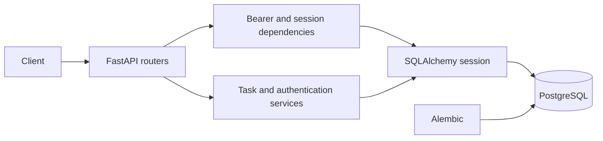
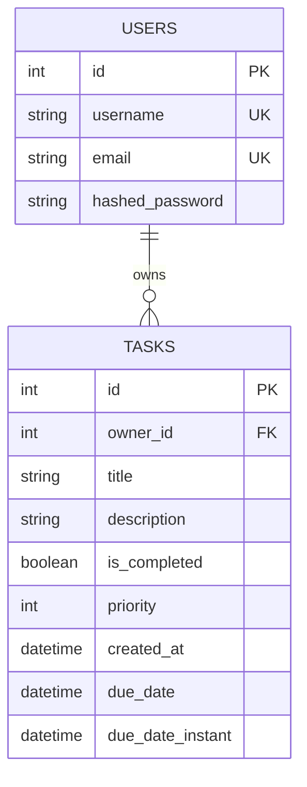

# Task Manager API

A FastAPI backend that lets users register, sign in, and manage a private
task list with deadlines and priorities. A bounded list endpoint supports
pagination, completion and priority filters, and deterministic sorting.

**Stack:** Python 3.11, FastAPI, Pydantic 2, SQLAlchemy 2, PostgreSQL,
Alembic, PyJWT, Docker Compose, and GitHub Actions.

## Architecture

The service is a modular monolith deployed as one web process. Each request
uses a SQLAlchemy session. Dependencies resolve the authenticated user, and
task services constrain queries to that user's ID. Services commit mutations,
while Pydantic schemas validate inputs and define public responses.



| Path | Responsibility |
| --- | --- |
| `app/routers/` | HTTP routes, status codes, and query parameters |
| `app/services/` | Task ownership, persistence, and authentication workflows |
| `app/core/` | Configuration, password hashing, and JWT primitives |
| `app/dependencies.py`, `app/database.py` | Request authentication and session lifecycle |
| `app/models.py`, `app/schemas.py` | Database mappings and API contracts |
| `app/utils/` | Error handling and response envelopes |
| `alembic/`, `tests/`, `.github/workflows/` | Schema revisions, regression tests, and CI |

## Database model



The owner foreign key is indexed and cascades on user deletion. A check
constraint allows at most one deadline representation per task. PostgreSQL
is the deployment database. SQLite is used for fast isolated tests.

## Start with Docker Compose

Install Docker with Linux containers, Compose v2, and Python 3.11 or newer for
the secret-generation command. From the repository root, create a local
`.env` if one does not already exist:

```powershell
if (-not (Test-Path .env)) {
    $jwt = python -c "import secrets; print(secrets.token_hex(32))"
    $db = python -c "import secrets; print(secrets.token_hex(24))"
    @("SECRET_KEY=$jwt", "POSTGRES_PASSWORD=$db") | Set-Content -Encoding ascii .env
}
docker compose up --build --wait --wait-timeout 120
curl.exe --fail http://127.0.0.1:8000/health
```

For a POSIX shell:

```sh
test ! -e .env && (
  umask 077
  jwt=$(python3 -c "import secrets; print(secrets.token_hex(32))")
  db=$(python3 -c "import secrets; print(secrets.token_hex(24))")
  printf 'SECRET_KEY=%s\nPOSTGRES_PASSWORD=%s\n' "$jwt" "$db" > .env
)
docker compose up --build --wait --wait-timeout 120
curl --fail http://127.0.0.1:8000/health
```

Compose starts PostgreSQL 14.25, runs Alembic in a one-shot service, and starts
the web service after migration succeeds. The API binds to loopback on the
host. Set `HTTP_PORT` to run a separate Compose project alongside another local
instance.

If `.env` already exists from a direct Python setup, supply
`POSTGRES_PASSWORD` before starting Compose. Generate one for a new database
volume or use the existing database password for an initialized volume.

Open Swagger UI at [localhost:8000/docs](http://127.0.0.1:8000/docs) or ReDoc at
[localhost:8000/redoc](http://127.0.0.1:8000/redoc). Use `docker compose down`
to stop the services and retain the database volume.

## Run directly with Python

Create a Python 3.11 virtual environment and install the requirements. Start a
local PostgreSQL database and set `DATABASE_URL` to its connection URL. Set a
random `SECRET_KEY` through your environment or a local copy of `.env.example`.
Use a disposable database for development and testing.

```powershell
py -3.11 -m venv .venv
.\.venv\Scripts\Activate.ps1
python -m pip install -r requirements.txt
python -m alembic upgrade head
python -m uvicorn app.main:app --reload
```

On a POSIX shell, create the environment with `python3.11 -m venv .venv`,
activate it with `. .venv/bin/activate`, and run the same install, migration,
and Uvicorn commands.

| Setting | Purpose |
| --- | --- |
| `DATABASE_URL` | PostgreSQL SQLAlchemy URL for direct runs. Compose supplies its internal URL using service host `db`. Percent-encode special characters in manually configured URLs. |
| `SECRET_KEY` | Required signing key of at least 32 characters. Generate a random value and keep it private. |
| `POSTGRES_PASSWORD` | Required by Compose. Use a hex string so it can be embedded in the Compose connection URL without escaping. |
| `HTTP_PORT` | Optional Compose host port, default `8000`. The container still listens on `8000`. |
| `ALGORITHM` | Optional, fixed to `HS256`. |
| `ACCESS_TOKEN_EXPIRE_MINUTES` | Positive integer, default `60`. |
| `REFRESH_TOKEN_EXPIRE_DAYS` | Positive integer, default `7`. |
| `ALLOWED_ORIGINS` | JSON array of explicitly allowed frontend origins. Defaults to an empty list. |
| `ENVIRONMENT` | `development`, `test`, or `production`. Defaults to `development`. |

Passwords use PBKDF2-SHA256 with 600,000 iterations. Successful login upgrades
older PBKDF2-SHA256 hashes when needed. Accounts from early bcrypt-based
revisions require an operator-managed password reset before they can sign in.
Use HTTPS and rate limits on authentication routes at your deployment
boundary. Keep database and JWT credentials outside Git. Application errors
use console logging, and validation responses omit the input values.
Successful token responses set `Cache-Control: no-store`.

## API and authentication

| Method and path | Authentication | Request or behavior |
| --- | --- | --- |
| `POST /auth/register` | Public | JSON with `username`, `email`, and `password`. Returns the account and both tokens. |
| `POST /auth/login` | Public | JSON with `identifier` (username or email) and `password`. Returns both tokens. |
| `POST /auth/refresh` | Refresh token | JSON with `refresh_token`. Returns a new access token for an existing account. |
| `POST /tasks/` | Access token | Creates a task for the authenticated user. `title` is required. |
| `GET /tasks/` | Access token | Lists the caller’s tasks. Optional parameters are `completed`, `priority`, `limit`, `offset`, `sort_by` (`created_at`, `title`, `is_completed`), and `sort_order` (`asc`, `desc`). |
| `GET /tasks/{task_id}` | Access token | Returns a task owned by the caller. |
| `PUT /tasks/{task_id}` | Access token | Applies only the submitted fields. Explicit null clears `description` or `due_date`. |
| `DELETE /tasks/{task_id}` | Access token | Deletes a task owned by the caller. |
| `GET /health` | Public | Returns application liveness. Compose separately gates startup on PostgreSQL and a successful migration. |

For task routes, send `Authorization: Bearer <access_token>`. Access tokens
and refresh tokens have distinct roles. Refresh tokens are reusable until
expiration while the account exists. This version keeps authentication
stateless to avoid introducing a session store and a second revocation
lifecycle. Signing-key rotation invalidates all outstanding tokens. Limit
refresh-token exposure in clients and use HTTPS when deploying.

List calls return up to 50 tasks by default. Set `limit` from 1 to 100 and
use `offset` to advance through pages. Equal sort values are ordered by task
ID so pages have a deterministic order for unchanged data. Use
`GET /tasks/?completed=false&priority=3&limit=20&offset=0` to fetch an example
page. Offset pagination can shift when tasks change between requests.

To run the requests in `test.http`, use an HTTP client that supports
`.http` files. Store the returned tokens as `accessToken` and
`refreshToken` in the client's private environment, and set `taskId` to
the ID returned when you create a task.

Example authenticated request:

```http
POST /tasks/
Authorization: Bearer <access_token>
Content-Type: application/json

{"title":"Review release","priority":2,"due_date":"2026-11-18T15:30:00+03:30"}
```

A successful create returns HTTP 201 and a response such as:

```json
{"success":true,"message":"Task created successfully","data":{"id":1,"title":"Review release","description":null,"is_completed":false,"priority":2,"due_date":"2026-11-18T12:00:00Z","owner_id":1,"created_at":"2026-11-18T11:00:00"}}
```

Successful responses have `success`, `message`, and `data` fields.
The health response contains `"data":{"status":"ok"}`. Error responses use the
same envelope with `success: false`. Invalid credentials return `401` with
`WWW-Authenticate: Bearer`. Missing tasks and tasks owned by another user
return `404`, duplicate registration returns `409`, and invalid inputs return
`422` with field errors in `data`. Unmapped database constraint violations
return a generic `400`.

```json
{"success":false,"message":"Input validation failed","data":[{"field":"title","message":"Field required"}]}
```

## Migration and timestamp policy

Revision `ef72b89db261` preserves existing creation times and deadlines as
stored. Missing and newly generated `created_at` values use a UTC wall-clock
value in the existing timezone-free column. Missing completion and priority
values become `false` and `1`. Existing email capacity is preserved.

New or replaced deadlines require an ISO 8601 offset and are returned in UTC.
A legacy deadline is returned without an offset because its timezone is
unknown. Omitting a deadline on update preserves it. Downgrade retains
backfilled values and refuses to drop the new deadline column while it contains
data. Missing owners and overlength legacy values in narrowed fields must be
resolved before upgrading.

Before migrating an existing database, confirm the deployment history and
inspect the schema. If an earlier draft of `ef72b89db261` was already applied,
Alembic will see the same revision ID. A forward reconciliation revision
must be designed against that database's actual schema and data provenance.
For populated databases, rehearse the upgrade and schedule a low-traffic
window. The revision holds exclusive locks on users and tasks until commit.
PostgreSQL 14 has reached end of life. Compose uses its final patch release
for compatibility with existing local volumes. Review the
[14.25 upgrade notes](https://www.postgresql.org/docs/release/14.25/) before
starting Compose with a volume initialized by an older 14.x release. For
public deployment, use a supported PostgreSQL major and plan a database
upgrade before switching any existing PostgreSQL 14 volume.

## Verification

With test-only `DATABASE_URL` and `SECRET_KEY` configured, for example
`DATABASE_URL=sqlite:///:memory:` for the app configuration during tests:

```sh
python -m pip install -r requirements-dev.txt
python -m pip check
ruff check app tests
ruff format --check app tests
python -m mypy app
python -m coverage run -m pytest -m "not postgresql"
python -m coverage report
python -m pytest -m postgresql
```

The first suite uses a fresh in-memory SQLite database per test and ORM
metadata. The second requires
`POSTGRES_TEST_DATABASE_URL` pointing to a **disposable PostgreSQL database**
whose test user can create and drop schemas. It creates a fresh schema and
runs Alembic before executing API requests. CI runs both suites on PostgreSQL
14 and 15 with Python 3.11, and checks lint, formatting, and application types. The fast suite enforces at least 85% combined
statement and branch coverage for application code. Direct and transitive
package versions are pinned in `requirements.txt` for Python 3.11 on Windows
and Linux. Development tools are pinned separately in
`requirements-dev.txt`. These are version pins without artifact hashes.

The image build context denies files by default. When adding runtime modules
or migrations, update `.dockerignore`. The CI image job checks application
files, tests exclusion with harmless sentinels, and smoke-tests Compose.

## Contributing

Create a branch, add targeted regression tests, and run the fast tests and
PostgreSQL integration tests before opening a pull request. Add an Alembic
revision for schema changes and a file-specific Docker allowlist entry if it
ships with the application. Keep local environment files, tokens, and
database dumps outside Git.

## License

[MIT](LICENSE)
